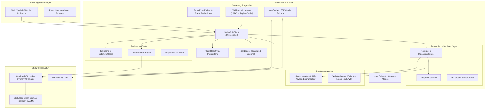
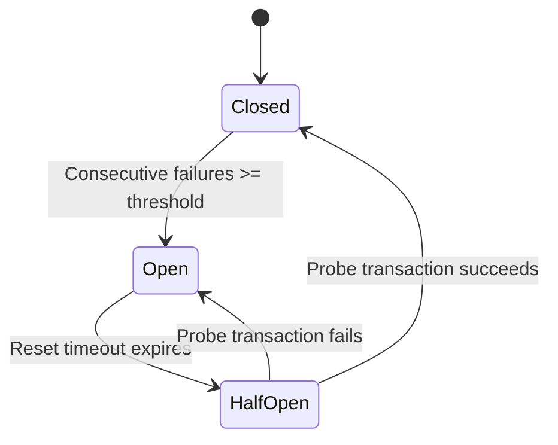
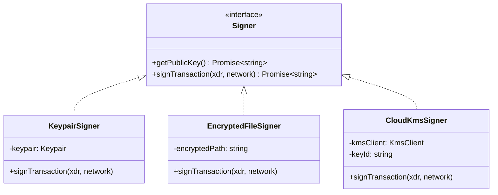
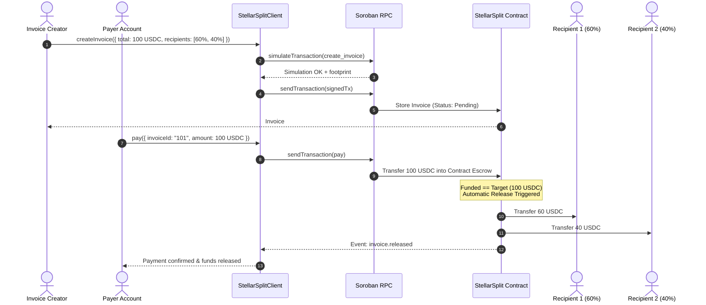
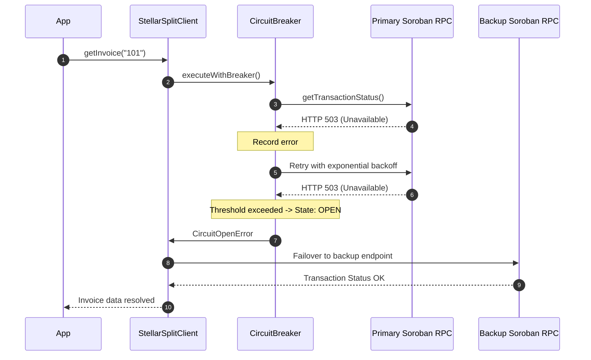
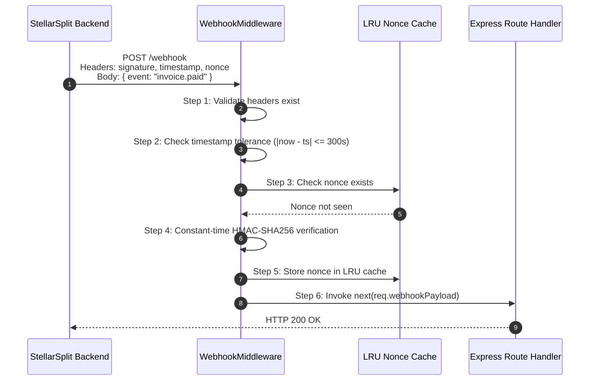

# StellarSplit SDK Architecture & Design Patterns

Comprehensive architectural documentation, system topology, design patterns, and component interactions for `@stellar-split/sdk`.

---

## Table of Contents

1. [System Topology & High-Level Architecture](#1-system-topology--high-level-architecture)
2. [Directory & Package Structure](#2-directory--package-structure)
3. [Core Architectural Subsystems](#3-core-architectural-subsystems)
   - [3.1 Client & Orchestration Layer](#31-client--orchestration-layer)
   - [3.2 Transaction Building & Footprint Optimization](#32-transaction-building--footprint-optimization)
   - [3.3 Resilience, Retry & Circuit Breaker Engine](#33-resilience-retry--circuit-breaker-engine)
   - [3.4 Pluggable Key Vault & Signer Adapters](#34-pluggable-key-vault--signer-adapters)
   - [3.5 Multi-Transport Event Streaming](#35-multi-transport-event-streaming)
   - [3.6 Webhook Security & Ingestion Pipeline](#36-webhook-security--ingestion-pipeline)
   - [3.7 Structured Debug Logging & Telemetry](#37-structured-debug-logging--telemetry)
4. [Design Patterns](#4-design-patterns)
   - [Adapter Pattern](#41-adapter-pattern)
   - [Circuit Breaker Pattern](#42-circuit-breaker-pattern)
   - [Optimistic State & Cache Invalidation](#43-optimistic-state--cache-invalidation)
   - [Typed Event-Driven Architecture](#44-typed-event-driven-architecture)
   - [Plugin & Middleware Interceptors](#45-plugin--middleware-interceptors)
5. [End-to-End Sequence Diagrams](#5-end-to-end-sequence-diagrams)
   - [Invoice Split & Disbursement Flow](#51-invoice-split--disbursement-flow)
   - [Resilient RPC Failover with Circuit Breaker](#52-resilient-rpc-failover-with-circuit-breaker)
   - [Webhook Signature & Replay Prevention](#53-webhook-signature--replay-prevention)
6. [Best Practices & Extension Guidelines](#6-best-practices--extension-guidelines)

---

## 1. System Topology & High-Level Architecture

The StellarSplit SDK serves as the primary TypeScript abstraction layer connecting enterprise backends, mobile clients, and web dApps to the StellarSplit Soroban smart contracts on the Stellar network.



---

## 2. Directory & Package Structure

The SDK is organized into clean, modular domain boundaries within `src/`:

```
src/
├── client.ts                 # StellarSplitClient: Main unified client orchestrator
├── configValidator.ts        # Configuration parsing, type coercion, and schema checks
├── logger.ts                 # SdkLogger: Structured levels, redact sensitive keys, formatters
├── errors.ts                 # Comprehensive typed error hierarchy with StellarSplitError base
├── types.ts                  # Domain models (Invoices, Recipients, Escrows, Milestones, Splits)
├── plugin.ts                 # Plugin lifecycle hooks and interceptor registry
│
├── builder/                  # Transaction and operation assembly
│   ├── OperationBuilder.ts   # Fluent builder for Soroban contract invocations
│   └── ...
├── soroban/                  # Low-level Soroban RPC integration
│   ├── footprint.ts          # Footprint optimization and simulation trimming
│   └── deploy.ts             # Contract installation and deployment utilities
│
├── resilience/               # Fault tolerance and circuit breaking
│   ├── CircuitBreaker.ts     # State machine (Closed, Open, HalfOpen)
│   ├── resilientRpc.ts       # Endpoint failover and healthy node rotation
│   └── retryPolicy.ts        # Exponential backoff and retryable classification
│
├── signing/                  # Cryptographic key management & signing
│   ├── signer.ts             # Core Signer interface
│   └── adapters/             # KeypairSigner, EncryptedFileSigner, CloudKmsSigner
│
├── adapters/                 # Web wallet integrations
│   ├── freighter.ts          # Freighter wallet extension
│   ├── ledger.ts             # Ledger Nano S/X hardware wallet via WebHID
│   ├── walletconnect.ts      # WalletConnect v2 integration
│   ├── xbull.ts              # xBull wallet extension
│   └── lobstr.ts             # Lobstr signer integration
│
├── events/                   # Event pub/sub infrastructure
│   └── TypedEventEmitter.ts  # Strongly-typed event dispatcher with wildcard support
│
├── cache/                    # Local caching and optimistic concurrency
│   ├── SdkCache.ts           # In-memory TTL cache with prune/expire events
│   └── OptimisticCache.ts    # Commit/rollback manager for immediate UI responsiveness
│
└── webhookMiddleware.ts      # Constant-time HMAC-SHA256 receiver with LRU nonce dedup
```

---

## 3. Core Architectural Subsystems

### 3.1 Client & Orchestration Layer
`StellarSplitClient` acts as the primary facade for consumers. It coordinates sub-modules:
- Validates network passphrases and contract addresses on startup.
- Manages connection lifecycle, keep-alives, and graceful shutdown drains.
- Injects plugins via `beforeMethod` and `afterMethod` lifecycle interceptors.
- Emits structured operational logs at configurable log levels (`debug`, `info`, `warn`, `error`).

### 3.2 Transaction Building & Footprint Optimization
Soroban transactions require declaring all storage keys accessed during execution (the ledger footprint). Oversized footprints increase resource fees and heighten contention.
1. **Simulation**: The SDK calls `simulateTransaction` on Soroban RPC.
2. **Footprint Diffing**: `footprintDiff` compares the initially declared ledger keys against the minimal read/write keys returned by the simulator.
3. **Re-assembly**: `optimizeFootprint` clones the transaction envelope using `SorobanDataBuilder`, applying only required keys while preserving sequence numbers and signatures.

### 3.3 Resilience, Retry & Circuit Breaker Engine
Distributed RPC endpoints on Stellar testnet and mainnet can experience temporary degradations or rate limits:
- **`CircuitBreaker`**: Tracks failure rates over rolling windows. When threshold consecutive errors occur, it trips to `OPEN`, immediately fast-failing calls to protect backend threads and triggering fallback RPC endpoints.
- **`isRetryable` Filter**: Evaluates error taxonomy (e.g. transient HTTP 503, connection reset vs permanent contract errors like `InvoiceNotFoundError`). Only transient errors trigger exponential backoff with jitter.



### 3.4 Pluggable Key Vault & Signer Adapters
The SDK supports diverse execution environments—from browser extensions to automated cloud daemons—through the unified `Signer` interface:
- **`KeypairSigner`**: Direct Stellar secret seed (`S...`) signing for serverless workers and local testing.
- **`EncryptedFileSigner`**: Password-protected encrypted PEM keystore with AES-GCM-256 for on-premise daemons.
- **`CloudKmsSigner`**: Hardware Security Module (HSM) signing via AWS KMS or Google Cloud KMS, preventing raw private keys from ever residing in application memory.
- **Browser Wallets**: Freighter, Lobstr, xBull, and WalletConnect adapters for web applications.

### 3.5 Multi-Transport Event Streaming
Invoice state transitions are delivered to client applications via tiered transport mechanisms:
1. **WebSocket**: Primary bidirectional real-time event channel.
2. **Server-Sent Events (SSE)**: HTTP-based streaming when WebSockets are blocked by proxies.
3. **RPC Polling Fallback**: Polling ledger events with exponential backoff if streaming transports disconnect.
4. **`StreamDeduplicator`**: Filters duplicate events across reconnects using paging tokens and transaction hashes.

### 3.6 Webhook Security & Ingestion Pipeline
For server-to-server notifications, `createWebhookMiddleware` provides a secure Express-compatible receiver:
- **Constant-Time Comparison**: Mitigates timing side-channel attacks by comparing HMAC buffers using bitwise XOR (`diff |= a[i] ^ b[i]`).
- **Timestamp Tolerance**: Enforces strict clock drift validation (default 300s window) to reject stale replayed payloads.
- **LRU Nonce Deduplication**: Tracks recently used nonces in an in-memory cache to reject duplicate transmissions.
- **`WebhookEventEmitter`**: Routes deliveries to typed event handlers (`invoice.created`, `invoice.paid`, `invoice.released`, `invoice.refunded`).

### 3.7 Structured Debug Logging & Telemetry
- **`SdkLogger`**: Provides hierarchical child namespaces (`StellarSplit:Client`, `StellarSplit:RPC`), custom sinks, pluggable formatters, and automatic secret redaction (Stellar seeds `S...` and sensitive dictionary keys).
- **OpenTelemetry**: Custom tracers instrument contract simulation, signing latency, and submission status.

---

## 4. Design Patterns

### 4.1 Adapter Pattern
Standardizes communication across disparate signing environments and external pricing feeds without polluting business logic.



### 4.2 Circuit Breaker Pattern
Protects applications against cascading failures during Soroban node outages. Decouples endpoint health monitoring from application business logic.

### 4.3 Optimistic State & Cache Invalidation
Provides instant feedback in responsive frontends. When an operation (such as `pay`) is initiated:
1. `OptimisticCache` applies expected state mutations immediately.
2. The transaction is submitted asynchronously to Stellar.
3. On confirmation, the optimistic state is committed; on failure or rejection, it automatically triggers rollback handlers.

### 4.4 Typed Event-Driven Architecture
The SDK implements a type-safe `TypedEventEmitter<T>` supporting full autocomplete and compile-time verification for all contract events. Handlers can subscribe to discrete events or register wildcard (`*`) audit listeners.

### 4.5 Plugin & Middleware Interceptors
Through `PluginRegistry`, developers can inject custom validation, metrics tracking, or authentication headers across all SDK operations without subclassing.

---

## 5. End-to-End Sequence Diagrams

### 5.1 Invoice Split & Disbursement Flow



### 5.2 Resilient RPC Failover with Circuit Breaker



### 5.3 Webhook Signature & Replay Prevention



---

## 6. Best Practices & Extension Guidelines

1. **Always Use Typed Amounts**: Use `parseAmount("10.5")` and `formatAmount(105000000n)` rather than floating-point math to avoid rounding inaccuracies in Stroop conversions.
2. **Redact Sensitive Secrets**: Keep `redactSensitive: true` enabled on `SdkLogger` so that private keys, auth headers, and secret seeds are never accidentally committed to centralized log aggregators.
3. **Tune Circuit Breaker Thresholds**: For high-throughput services, configure `CircuitBreakerOptions` with appropriate rolling error percentages to avoid premature failovers during brief network blips.
4. **Subscribe to Life-Cycle Cleanups**: In server applications, ensure `client.dispose()` is called during `SIGTERM` / `SIGINT` to drain in-flight operations and close open WebSocket connections.
